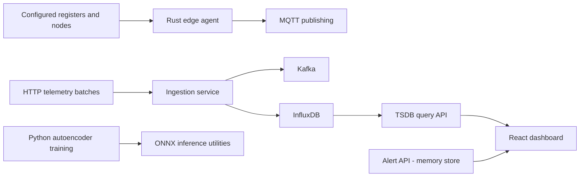
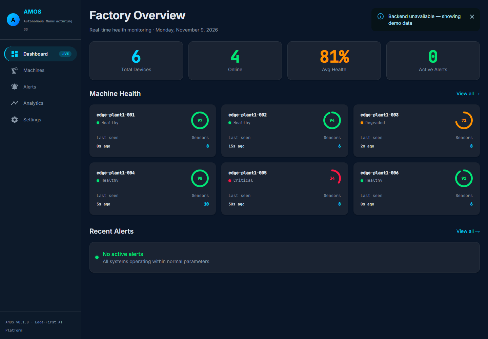
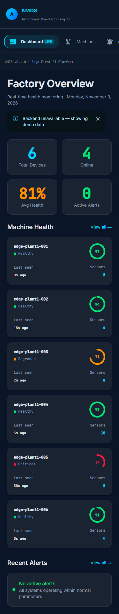

# AMOS — Autonomous Manufacturing OS prototype

AMOS is a manufacturing telemetry and predictive-maintenance prototype: a Rust edge-agent scaffold, Python FastAPI services, autoencoder training/ONNX inference utilities, and a React dashboard. It is useful for studying the boundaries between industrial telemetry, anomaly scoring, storage and operator workflows.

## Source architecture



This is a source map, not evidence of an end-to-end deployment. In particular, the edge MQTT publisher and HTTP ingestion service require integration; the diagram does not imply an implemented MQTT-to-HTTP bridge.

## Implemented and incomplete behavior

- `edge-agent/src/collectors/` constructs Modbus and OPC UA readings. The Modbus collector currently emits zero-valued placeholders rather than reading a PLC. Do not connect this scaffold to production machinery as a validated collector.
- `cloud-core/ingestion-service/` accepts telemetry and contains Kafka/InfluxDB clients. `tsdb-service/` queries time series, machines and summaries. Its anomalies endpoint is a stub.
- `cloud-core/alert-service/` creates, filters, acknowledges and resolves alerts in process memory. Restarting loses alerts. Configured high/critical alerts can send Slack webhooks.
- `ai-engine/` contains autoencoder training, ONNX export, scoring and sliding-window helpers. A usable trained artifact and representative telemetry are prerequisites; no predictive accuracy is established here.
- `dashboard/` presents machines and alerts. Overview substitutes demo machines on failure or an empty result; analytics contains generated values. Settings currently changes component state and shows a success message without persisting backend configuration.
- Compose and Kubernetes files are development templates. Default credentials, unauthenticated APIs, directly interpolated Flux query inputs and failure-masking CI steps need work before any network deployment.

There is no verified downtime reduction, cost saving, real-PLC benchmark, production readiness or deployment result in this audit. Earlier numerical benefit claims have been removed.

## Local development

The dashboard requires Node/npm and the backend services it calls. From `dashboard/`:

```sh
npm ci --ignore-scripts
npm run dev
```

The Vite server uses port 5173. Its versioned API proxies target TSDB on 8002 and alerts on 8003; the health proxy rewrites to the TSDB `/health` route. Production hosting needs an equivalent reverse proxy because Vite development proxy rules are not included in static bundles.

Review `cloud-core/docker-compose.yml` and replace credentials before using the backend locally. Starting it downloads container images and opens service ports; the audit did not start it. Rust development starts at `edge-agent/Cargo.toml`; Python service requirements are separate per service.

## Checks and audit status — 2026-11-09

```sh
cd dashboard
node --test tests/proxy.test.mjs
npm run build
```

The four proxy regressions failed against the original configuration and pass after repair. They verify route selection, not live service responses. A lifecycle-disabled dependency install completed after an elevated retry; the dashboard production build passed (Vite reports a bundle-size warning). Browser inspection also reproduced and repaired duplicate sidebar spacing on desktop and narrow-screen horizontal overflow. At 1440px the main area starts at the 240px drawer boundary; at 390px the browser confirms no horizontal document overflow.





The images are actual local frontend captures with no backend services running. The “Backend unavailable — showing demo data” banner identifies the generated machines; their health values are not hardware readings. No PLC, Docker cluster, trained model or live webhook was exercised. Production hosting still requires its own reverse proxy.

See `docs/architecture.md`, `docs/api-reference.md` and `docs/deployment.md` for historical design material; those documents describe intent and require independent validation against the current code.
